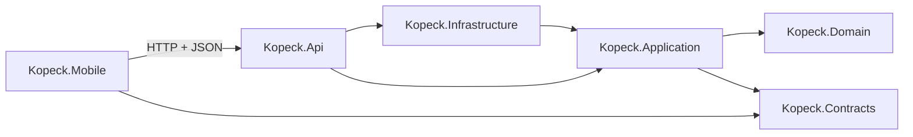

# Kopeck (.NET MAUI + ASP.NET Core)

A mobile budgeting app that replaces the "Main Buget.xlsx" workflow: categories with a monthly plan, "Left" per category,
how much a category went over its plan, multiple income streams, and sharing a budget with other people.

- **App:** .NET 8 MAUI for Android and iOS (MVVM)
- **API:** ASP.NET Core 8 Web API with controllers, Clean Architecture, EF Core + SQLite
- **Everything is open source** (see [Packages](#packages))

## Contents

- [Excel → app mapping](#excel--app-mapping)
- [Features](#features)
- [Business logic](#business-logic)
- [Architecture](#architecture)
- [API reference](#api-reference)
- [Security](#security)
- [Packages](#packages)
- [Run it](#run-it)
- [Configuration](#configuration)
- [Database and migrations](#database-and-migrations)
- [Tests and CI](#tests-and-ci)
- [Known gaps](#known-gaps)

## Excel → app mapping

| Excel | App |
|---|---|
| Summary sheet, `Planned` column per category | **Plan** screen (planned amount per category per month) |
| `Left` = `Planned - SUMIF(expenses by category)` | Dashboard "Left" per category, plus **"Over by X"** when spending exceeds plan |
| Expense list (Amount / Category) | **Expenses** screen: each expense is assigned to a category |
| Details sheet: Salaries / Other, monthly columns | **Income** screen: any number of revenue streams, entries dated per month |
| MDL/EUR savings sheet | **Savings** tab: pots (e.g. Emergency fund) with their own currency, target and deposit history |
| Duplicating last month's sheet | "Copy missing amounts from previous month" on the Plan screen |
| Sharing the file | **Share dashboard**: invite by email as Viewer or Editor |

Not carried over (kept simple on purpose): currency conversion (amounts in different currencies are shown side by side,
never converted) and the "weekly planning" split of Home into W1–W5.

## Features

| Area | What you can do |
|---|---|
| Account | Register with email, verify with a 6-digit emailed code, sign in, resend the code, forgot / reset password |
| Budgets | Create budgets (name + default currency picked from a list), open one, delete it (owner), leave a shared one |
| Categories | Add, rename, delete (refused while expenses use it). Names are unique per budget, case-insensitive. **Star** the ones you use most: they come first in the category list, the expense picker, the Overview and the plan. Stars are personal, so in a shared budget each member has their own |
| Expenses | Add, **edit** (swipe → Edit) and delete; each expense belongs to a category and a date. The edit sheet shows who added and last changed it, and **History** lists every action: who, when, and each value before → after (kept even after a delete) |
| Income | Any number of named revenue streams, each in its own currency (the budget's by default); dated income entries per stream |
| Savings | Pots with a name, currency (the budget's by default) and optional target; add or take out money, see balance, progress and history |
| Plan | Planned amount per category per month, saved **all-or-nothing**; copy missing amounts from the previous month |
| Dashboard | Per category: Planned, Spent, Left / Over by, % used, status colour, and a **+** that opens a new expense in that category for the month on screen (editors). Totals: income, planned, spent, saved, overspend, left (income − spent − saved), with other currencies listed separately |
| Charts | Overview: "Where it went" split bar of this month's spending by category. **Year** screen: income vs spent per month, or one category's spent vs planned; tap a month for its numbers; every category's share of the year. Budget currency only |
| Sharing | Owner invites by email as Viewer (read-only) or Editor (can change data); works for people who register later |

### Sharing model

A budget *is* the dashboard. The owner shares it by email as **Viewer** or **Editor**. Shares are keyed by verified email,
so inviting someone who hasn't registered yet works once they sign up with that address. Only the owner can rename or
delete the budget and manage shares; a shared user can leave. People without access get **404** (not 403), so budget ids
can't be probed.

| Action | Viewer | Editor | Owner |
|---|:-:|:-:|:-:|
| See dashboard, categories, expenses, income, plans, savings | ✅ | ✅ | ✅ |
| Star categories (personal) | ✅ | ✅ | ✅ |
| Add / edit / delete categories, expenses, income, plans, savings | | ✅ | ✅ |
| Rename / delete the budget, manage shares | | | ✅ |
| Leave the budget | ✅ | ✅ | |

## Business logic

### Planned vs real (`Kopeck.Domain/Planning/PlanVsActual.cs`)

For each category in a month, with `Planned` = the plan for that month and `Spent` = the sum of its expenses dated in that month:

| Value | Formula |
|---|---|
| Left | `Planned − Spent` (negative when overspent) |
| Over by | `max(0, Spent − Planned)` |
| % used | `Spent / Planned × 100` (rounded to 0.1); `100` when spent without a plan; `0` when neither |

| Status | Rule (checked in this order) | Colour |
|---|---|---|
| Unused | no plan and no spending | grey |
| Unplanned | spending without a plan | purple |
| Over | spent more than planned | red |
| Warning | spent ≥ 80% of the plan | amber |
| On track | otherwise | green |

Month totals: **Total overspend** = sum of "Over by"; **Unallocated** = income − planned; **Net left** = income − spent.
Categories are listed with the biggest overspend first. A month is always identified by its first day; any date in
the month is accepted by the API.

### Other rules (`Kopeck.Domain/Common/DomainRules.cs`)

- Amounts: greater than 0 (plans may be 0), at most 2 decimals, at most 1,000,000,000,000. Stored as `decimal(18,2)`.
- Names (budget, category, stream, display name): required, at most 80 characters, trimmed.
- Notes: optional, trimmed, cut to 200 characters. Category colour: `#RRGGBB`, default `#6C757D`.
- Currency: 3–5 letters, upper-cased (EUR, MDL, ...). Fixed once the budget is created.
- Emails: plain addresses only, stored lower-cased.
- Passwords: 8–128 characters with at least one letter and one digit.
- "Copy from previous month" never overwrites a plan that already exists.
- Deleting a category with expenses, or an income stream with entries, is refused (409). Deleting a budget removes
  everything under it (database cascade).

## Architecture

The API follows **Clean Architecture**: dependencies point inwards, and the business rules know nothing about HTTP,
EF Core, SMTP or JWT.



| Project | Responsibility | Depends on |
|---|---|---|
| `Kopeck.Contracts` | DTOs and JSON settings shared by API and app (single source of truth for the wire format) | — |
| `Kopeck.Domain` | Entities with behaviour (private setters, factory/constructor invariants), business rules, `PlanVsActual` | — |
| `Kopeck.Application` | Use cases (one service per feature, behind an interface), `Result`/`Error`, abstractions it needs | Domain, Contracts, EF Core (no provider) |
| `Kopeck.Infrastructure` | EF Core + SQLite, migrations, JWT, PBKDF2 hashing, queued email over SMTP | Application |
| `Kopeck.Api` | Composition root, endpoints, auth, rate limiting, error handling, result → HTTP mapping | Application, Infrastructure |
| `Kopeck.Mobile` | MAUI app (MVVM) | Contracts |

### Folder layout

```
src/
  Kopeck.Contracts/Dtos.cs              requests, responses, enums, shared JSON options
  Kopeck.Domain/
    Common/                             DomainRules, IBudgetOwned, month helpers
    Users/                              User (codes, lockout), OneTimeCode, PasswordPolicy
    Budgets/                            Budget, BudgetShare, AccessLevel
    Categories/ Expenses/ Incomes/      Category, Expense, IncomeStream, Income
    Planning/                           PlannedExpense, PlanVsActual + SpendingStatus
    Savings/                            SavingsPot, SavingsEntry (signed amount: deposit +, withdrawal −)
  Kopeck.Application/
    Abstractions/                       IKopeckDbContext, ICurrentUser, IEmailSender, IPasswordHasher, ITokenService
    Common/                             Result, Error, mappings (domain → DTO), InBudget() query filter
    Auth/ Budgets/ Categories/ Expenses/ Incomes/ Planning/ Savings/   one service per feature
    Validation/                         IRequestValidator<T>, IRequestPipelineExecutor, ValidationResult
      Validators/                       one validator per request (format rules only)
    DependencyInjection.cs              AddApplication() (validators registered by assembly scan)
  Kopeck.Infrastructure/
    Persistence/                        KopeckDb, Configurations/ (one per entity), Migrations/, DatabaseErrors
    Identity/                           JwtTokenService + JwtOptions, IdentityPasswordHasher
    Email/                              QueuedEmailSender, EmailDispatchWorker, SMTP / log transports
    DependencyInjection.cs              AddInfrastructure()
  Kopeck.Api/
    Program.cs                          composition root
    Controllers/                        ApiControllerBase (maps Result → HTTP) + one controller per resource
    Filters/                            BudgetAccessAttribute + BudgetAccessFilter, RequestValidationFilter<T>
    Http/                               WebApiSetup, HttpCurrentUser, RateLimitOptions, UniqueConstraintExceptionHandler
  Kopeck.Mobile/
    Services/                           IApiClient, typed feature APIs (IAuthApi, IExpensesApi, ...), IUserSession, IServerSettings,
                                        AppState, navigation / dialog services
    ViewModels/                         BaseViewModel, BudgetViewModel, one view model per screen
    Views/                              BasePage + XAML pages (compiled bindings, x:DataType)
tests/Kopeck.Api.Tests/                 unit tests + integration tests over the real HTTP pipeline
```

### How a request flows

```
HTTP request
  → rate limiter (auth routes) → JWT authentication
  → [BudgetAccess(level)]         resolves the caller's access to /api/budgets/{budgetId}: none → 404, too low → 403
  → RequestValidationFilter<T>    [ServiceFilter] on actions with a body: runs IRequestValidator<T>, all failures → one 400
  → controller action (one line)  calls the feature service
  → service (Application)         rules that need the database or the user (unknown category, duplicate name,
                                  sharing with yourself), loads entities, calls domain methods, SaveChanges (one transaction)
  → Result / Result<T>            ApiControllerBase maps it: 200/201/204, 400, 401, 403, 404, 409
```

A save that loses a race on a unique index (two identical names at once) is turned into **409** by
`UniqueConstraintExceptionHandler` instead of a 500.

### Design patterns and principles

| Pattern / principle | Where |
|---|---|
| Clean Architecture, dependency inversion | Application defines `IKopeckDbContext`, `IEmailSender`, `ITokenService`, `IPasswordHasher`, `ICurrentUser`; Infrastructure and Api implement them |
| Rich domain model | Entities change only through methods (`Category.Rename`, `Expense.Update`, `User.TryConfirmEmail`, `BudgetShare.ChangeRole`) |
| Unit of Work | `IKopeckDbContext.SaveChangesAsync` commits one use case in one transaction (e.g. bulk plan save) |
| Result pattern | Expected failures are values (`Error.Validation/NotFound/Conflict/Forbidden/Unauthorized`), exceptions are for the unexpected |
| Single responsibility | One service per feature; one `IEntityTypeConfiguration` per entity; one place maps results to HTTP |
| Interface segregation | Services are injected by narrow interfaces; the app's API is split per feature (`IAuthApi`, `IExpensesApi`, ...) |
| Open/closed | Controllers are discovered by MVC: a new feature is a new controller, not an edit to `Program.cs` |
| Strategy | Email transport: SMTP in real environments, the log in Development |
| Producer / consumer | Emails go into a bounded `Channel`; a `BackgroundService` sends them |
| Adapter | `IdentityPasswordHasher` over ASP.NET Identity, `HttpCurrentUser` over the JWT claims |
| Pipeline / chain of responsibility | MVC action filters: budget access and minimum role, then request validation |
| Validator | `IRequestValidator<T>` per request, run by `RequestValidationFilter<T>`; a test fails if an action forgets the filter |
| Options pattern | `JwtOptions`, `SmtpOptions`, `RateLimitOptions` bound from configuration |
| MVVM + gateway (app) | View models use typed feature APIs over one `IApiClient`; platform storage injected (`ISecureStorage`, `IPreferences`) |
| Template method (app) | `BasePage` forwards appear/disappear to the view model; `BaseViewModel.RunAsync` handles busy flag, errors and cancellation |

### Mobile app

- **Screens:** Login, Register, Verify, Reset password, Budgets, Dashboard, Expenses, Income, Savings, Savings pot, Plan,
  Year, Categories, Share.
- **Charts:** drawn with MAUI `GraphicsView` (`Views/Charts`), no chart library. Colours follow the category (fixed order,
  a neutral "other" after eight), picked for light or dark and rebuilt when the theme changes; amounts are always shown as text too.
- **Navigation:** Shell routes; `//login` and `//budgets` are roots. An open budget has five tabs (Overview, Expenses,
  Income, Savings, More; Android shows at most five). The monthly plan is pushed from Overview ("Edit plan") and More.
- **State:** `AppState` holds the open budget and month. The JWT lives in secure storage (Keychain / Android Keystore),
  never in preferences. When the server rejects the token, the session expires and the app returns to sign-in.
- **Requests:** every command runs through `BaseViewModel.RunAsync`, which shows a busy indicator, turns API errors into
  a message, logs unexpected errors, and cancels the request when the page goes away.
- **New entries** default to today when viewing the current month, otherwise to the first day of the month on screen.
- **Currencies:** pickers offer `Contracts.Currencies.Common` with the budget currency first. Totals in several currencies
  are shown side by side (`2,850.00 EUR · 300.00 USD`).

## API reference

All routes are under `/api`. Everything except `/api/auth/*` and `/health` needs `Authorization: Bearer <token>`.
Months are passed as a date (`2026-10-01`); any day in the month works.

| Method | Route | Access | Notes |
|---|---|---|---|
| POST | `/auth/register` | anonymous | always 202 |
| POST | `/auth/resend-code` | anonymous | always 202 |
| POST | `/auth/verify-email` | anonymous | returns a token |
| POST | `/auth/login` | anonymous | 401 wrong/locked, 403 email not verified |
| POST | `/auth/forgot-password` | anonymous | always 202 |
| POST | `/auth/reset-password` | anonymous | 204 |
| GET / POST | `/budgets` | signed in | list mine (owned + shared) / create |
| PUT / DELETE | `/budgets/{id}` | Owner | rename / delete with everything under it |
| GET | `/budgets/{id}/summary?month=` | Viewer | dashboard for one month |
| GET | `/budgets/{id}/summary/year?year=` | Viewer | 12 months of income / planned / spent / saved, and per-category totals by month (budget currency) |
| DELETE | `/budgets/{id}/leave` | Viewer | a shared user leaves |
| GET / POST | `/budgets/{id}/shares` | Owner | list / share (sharing again changes the role) |
| DELETE | `/budgets/{id}/shares/{shareId}` | Owner | revoke |
| GET / POST | `/budgets/{id}/categories` | Viewer / Editor | |
| PUT / DELETE | `/budgets/{id}/categories/{categoryId}` | Editor | delete → 409 while expenses use it |
| PUT / DELETE | `/budgets/{id}/categories/{categoryId}/star` | Viewer | star / unstar for the caller only; lists, plans and the summary put starred first |
| GET | `/budgets/{id}/expenses?month=&categoryId=` | Viewer | |
| POST | `/budgets/{id}/expenses` | Editor | |
| PUT / DELETE | `/budgets/{id}/expenses/{expenseId}` | Editor | |
| GET | `/budgets/{id}/expenses/{expenseId}/history` | Viewer | who added / changed / deleted it, when, and the values (newest first) |
| GET / POST | `/budgets/{id}/income-streams` | Viewer / Editor | `currency` is optional (budget currency) |
| DELETE | `/budgets/{id}/income-streams/{streamId}` | Editor | 409 while it has entries |
| GET | `/budgets/{id}/incomes?month=` | Viewer | |
| POST | `/budgets/{id}/incomes` | Editor | |
| DELETE | `/budgets/{id}/incomes/{incomeId}` | Editor | |
| GET | `/budgets/{id}/plans?month=` | Viewer | every category with its planned amount (0 if none) |
| PUT | `/budgets/{id}/plans` | Editor | one category/month (0 clears it) |
| PUT | `/budgets/{id}/plans/bulk` | Editor | several categories, one transaction, all or nothing |
| GET / POST | `/budgets/{id}/savings` | Viewer / Editor | pots with balance; `currency` optional (budget currency) |
| PUT / DELETE | `/budgets/{id}/savings/{potId}` | Editor | currency changes only while empty (409); delete removes the history |
| GET / POST | `/budgets/{id}/savings/{potId}/entries` | Viewer / Editor | `kind` Deposit / Withdrawal; can't take out more than the balance (400) |
| DELETE | `/budgets/{id}/savings/{potId}/entries/{entryId}` | Editor | 409 if it would leave the pot below zero |
| POST | `/budgets/{id}/plans/copy` | Editor | copy missing plans from one month to another; returns `{ "copied": n }` |
| GET | `/health` | anonymous | liveness |

Errors use one shape: `{ "error": "message" }` (404 has no body).

## Security

- **Passwords:** PBKDF2 via ASP.NET Identity's `PasswordHasher` (salted, versioned).
- **Lockout:** 5 wrong passwords lock the account for 15 minutes. Lockout bookkeeping ignores request cancellation, so
  aborting the request can't skip it.
- **Email codes:** 6 digits from a CSPRNG, stored as SHA-256, compared in constant time, single use, expire after
  15 minutes, lock after 5 wrong tries.
- **No account enumeration:** register, resend and forgot-password always answer 202; login always runs a password hash
  (a dummy one for unknown emails); emails are queued so response time doesn't depend on whether one is sent.
- **Tokens:** HS256 JWT signed with `Jwt:Key` (32+ bytes, from configuration, never in code). Lifetime 7 days by default.
- **Rate limiting:** `/api/auth/*` is limited per client IP (20/minute by default).
- **Authorization:** one filter resolves access for every budget route; strangers get 404.
- **Transport:** HSTS + HTTPS redirection outside Development. Release builds of the app only accept `https` server
  addresses; plain HTTP is allowed only in Debug builds on Android.
- **Logs:** recipient addresses are masked in email error logs. The Development-only log transport prints whole emails
  (including codes) so you can test without SMTP; it is never registered outside Development.

## Packages

All open source and free to use. API-side versions are pinned in `Directory.Packages.props` (central package management).
The MAUI app keeps its own versions because the MAUI workload pins `Microsoft.Maui.*`.

| Package | Version | Used by | Licence |
|---|---|---|---|
| Microsoft.EntityFrameworkCore | 8.0.34 | Application | MIT |
| Microsoft.EntityFrameworkCore.Sqlite | 8.0.34 | Infrastructure | MIT |
| Microsoft.EntityFrameworkCore.Design | 8.0.34 | Api (for `dotnet ef`) | MIT |
| Microsoft.AspNetCore.Authentication.JwtBearer | 8.0.34 | Api | MIT |
| System.IdentityModel.Tokens.Jwt | 7.7.3 | Infrastructure | MIT |
| MailKit | 5.0.0 | Infrastructure | MIT |
| Microsoft.Maui.Controls | `$(MauiVersion)` | Mobile | MIT |
| CommunityToolkit.Mvvm | 8.2.2 | Mobile | MIT |
| Microsoft.Extensions.Logging.Debug | 8.0.0 | Mobile | MIT |
| xunit / xunit.runner.visualstudio | 2.5.3 | Tests | Apache-2.0 |
| Microsoft.AspNetCore.Mvc.Testing | 8.0.34 | Tests | MIT |
| Microsoft.NET.Test.Sdk | 17.8.0 | Tests | MIT |
| coverlet.collector | 6.0.0 | Tests | MIT |

Tools: `dotnet-ef` 8.0.34 (local tool, `.config/dotnet-tools.json`). SDK: .NET 8.0.428 (`global.json`).

## Run it

For a step-by-step Windows setup without Android Studio (Android SDK, emulator, Rider), see [SETUP.md](SETUP.md).

```powershell
# API (Development: emails, including verification codes, are written to the console instead of sent)
dotnet run --project src/Kopeck.Api --urls http://0.0.0.0:5080
```

```powershell
# Tests
dotnet test tests/Kopeck.Api.Tests
```

`Kopeck.sln` includes the MAUI app, which needs the Android SDK to build. Without it, open or build
`Kopeck.Backend.slnf` instead (every project except the mobile app):

```powershell
dotnet build Kopeck.Backend.slnf
```

Mobile app (needs the MAUI workload, a JDK and the Android SDK; iOS also needs a Mac with Xcode):

```powershell
dotnet workload install maui
```

```powershell
dotnet build src/Kopeck.Mobile -f net8.0-android -t:Run
```

The server address is editable on the sign-in screen (default `http://10.0.2.2:5080` for the Android emulator,
`http://localhost:5080` for the iOS simulator).

## Configuration

Set these as environment variables or in a secret store; never commit them. `__` is the section separator.

| Setting | Default | Notes |
|---|---|---|
| `Jwt__Key` | random per start in Development | **Required** outside Development; 32+ bytes |
| `Jwt__LifetimeHours` | `168` (7 days) | |
| `Smtp__Host` | — | **Required** outside Development (the API refuses to start without it) |
| `Smtp__Port` | `587` | STARTTLS |
| `Smtp__User`, `Smtp__Password` | — | optional |
| `Smtp__From` | `no-reply@localhost` | |
| `ConnectionStrings__Default` | `Data Source=kopeck.db` | SQLite; swap the provider for PostgreSQL in production |
| `RateLimit__AuthPerMinute` | `20` | per client IP on `/api/auth/*` |
| `ForwardedHeaders__Enabled` | `false` | set to `true` behind a reverse proxy so rate limiting sees client IPs |
| `Database__MigrateOnStartup` | `false` | apply migrations at startup (single-instance setups only) |

Serve the API over HTTPS.

## Database and migrations

Schema comes from EF Core migrations in `src/Kopeck.Infrastructure/Persistence/Migrations`. Every budget-owned table has
a cascading foreign key to its budget; expenses block deleting their category; income entries block deleting their stream.

```powershell
# after changing the model
dotnet dotnet-ef migrations add <Name> --project src/Kopeck.Infrastructure --startup-project src/Kopeck.Api --output-dir Persistence/Migrations
```

```powershell
# on deploy
dotnet dotnet-ef database update --project src/Kopeck.Infrastructure --startup-project src/Kopeck.Api
```

```powershell
# check the model and the last migration agree
dotnet dotnet-ef migrations has-pending-model-changes --project src/Kopeck.Infrastructure --startup-project src/Kopeck.Api
```

Migrations auto-apply in Development; elsewhere run them as a deployment step, or set `Database__MigrateOnStartup=true`
for a single instance.

## Tests and CI

**39 tests** in `tests/Kopeck.Api.Tests` (xUnit):

- **Unit:** planned-vs-actual maths and status, email codes (single use, expiry, attempt lock), account lockout,
  password policy, email/currency rules, budget access levels, log masking.
- **Integration** (`WebApplicationFactory`, in-memory SQLite, real HTTP pipeline): sign-up and login, lockout, password
  reset, planned-vs-real dashboard with several income streams, sharing roles and 404 for strangers, cascade delete,
  decimal validation, all-or-nothing bulk plan save, expense edit within the same budget.

**GitHub Actions** (`.github/workflows/ci.yml`): API build and tests on every PR and on `develop`; Android build;
iOS build is manual (`workflow_dispatch`) because it needs a macOS runner.

**Quality gates:** `Directory.Build.props` enables nullable reference types, latest analyzers and code-style checks, and
turns warnings into errors for every project except the MAUI app; `.editorconfig` sets the style.

## Known gaps

- **Not yet tried on a device or emulator**, and the iOS build has never run. The Android build runs in CI.
- **Tokens survive a password reset:** there are no refresh tokens and no revocation; a token lasts until it expires
  (7 days by default).
- **No invite email:** people you share a budget with are not notified.
- **No unit tests for the mobile view models** yet (they are written to be testable).
- Income entries can't be edited and streams can't be renamed.
- Single currency per budget; no recurring expenses, charts, or import of the existing xlsx.
- The app id `com.example.kopeck` is a placeholder, and iOS `Info.plist` still allows
  local-network HTTP; fix both before a release.
